<div align="center">



<br/>

<a href="https://bhavesh.fun"></a>
<a href="https://linkedin.com/in/bhavesh0327"></a>
<a href="https://x.com/bhavesh0327"></a>


</div>

<br/>

<details>
<summary><code>0x01</code> &nbsp;<b>how i build</b> &nbsp;<sub><code>$ traceroute --explain how-i-build</code></sub></summary>
<br/>



```diff
+ invariants live in the database, not in the code that happens to call it
+ retries are idempotent, and therefore boring
+ versions are pinned, and bumped on purpose
+ personal data never leaves the box; the model comes to it
- "works on my machine"
```

</details>

<details>
<summary><code>0x02</code> &nbsp;<b>services exposed</b> &nbsp;<sub><code>$ nmap -sV -p- bhavesh0327</code></sub></summary>
<br/>



</details>

### `0x03` &nbsp;telemetry



### `0xff` &nbsp;capture the flag

<details>
<summary><code>you made it this far. there's a flag in here.</code></summary>
<br/>

```sh
$ echo ZmxhZ3t5MHVfcjM0ZF83aDNfd2gwbDNfcjM0ZG0zfQ== | base64 -d
```

</details>
